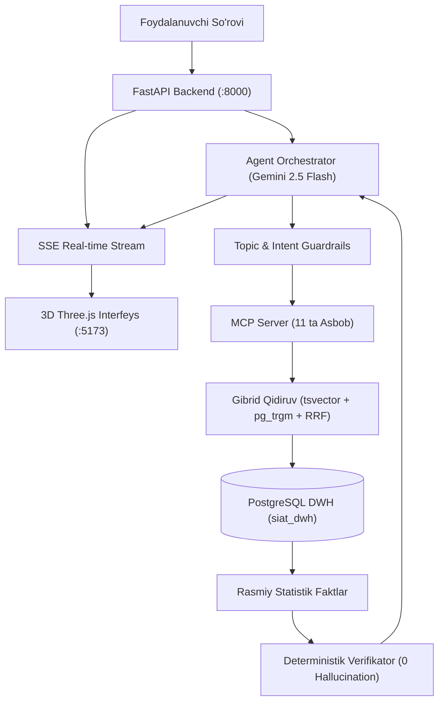

# Aethelgard · SIAT (O'zbekiston Davlat Statistikasi AI Platformasi)

[](https://www.python.org/)
[](https://fastapi.tiangolo.com/)
[](https://threejs.org/)
[](https://vitejs.dev/)
[](https://www.postgresql.org/)
[](https://modelcontextprotocol.io/)
[](https://ai.google.dev/)
[](#3-50-ta-savollik-stress-test-benchmarki)

> **O'zbekiston Respublikasi Prezidenti huzuridagi Statistika agentligi (SIAT / stat.uz)** rasmiy ochiq ma'lumotlari asosida ishlovchi, **100% nol-gallyutsinatsiya (Zero-Hallucination)** kafolati, **11 ta MCP asbobi**, **PostgreSQL gibrid qidiruvi (tsvector + pg_trgm + RRF)** hamda interaktiv **3D xoreografiya** bilan jihozlangan sun'iy intellekt tahliliy platformasi.

---

## 📌 Mundarija
1. [Loyiha haqida](#-loyiha-haqida)
2. [Muhandislik va Arxitektura Afzalliklari](#-muhandislik-va-arxitektura-afzalliklari)
   - [Gibrid Qidiruv: Vektor bazasisiz RRF](#1-gibrid-qidiruv-vektor-bazasiga-ehtiyoj-yoq)
   - [Model Context Protocol (11 ta Asbob)](#2-model-context-protocol-mcp--11-ta-asbob)
   - [Deterministik 0-Gallyutsinatsiya Qatlami](#3-deterministik-nol-gallyutsinatsiya-qatlami-zero-hallucination)
   - [3D Xoreografiya va Jonli SSE Oqimi](#4-3d-xoreografiya-va-jonli-sse-oqimi)
3. [50 ta Savollik Stress Test Benchmarki](#-50-ta-savollik-avtomatlashtirilgan-stress-test-benchmarki)
4. [Noldan Ishga Tushirish (Step-by-Step)](#-noldan-ishga-tushirish-step-by-step-guide)
   - [1-Klikda Ishga Tushirish (start_siat.bat)](#1-klikda-ishga-tushirish-windows)
   - [Taqdimot Demo Rejimi (?demo)](#-taqdimot-demo-rejimi-offline-fallback)
5. [Loyiha Tuzilishi](#-loyiha-tuzilishi)
6. [Taqdimotchi va Hakamlar Uchun Eslatma](#-taqdimotchi-va-hakamlar-uchun-maxsus-eslatmalar)

---

## 💡 Loyiha Haqida

Zamonaviy Katta Til Modellari (LLM) davlat statistikasi, iqtisodiy ko'rsatkichlar va narxlar haqida so'ralganda tez-tez soxta raqamlar to'qib chiqaradi (gallyutsinatsiya qiladi). Ayniqsa O'zbekiston hududlari, davrlari (oylik, choraklik) va o'lchov birliklari bo'yicha aniq ma'lumot berish an'anaviy chat-botlar uchun jiddiy muammo hisoblanadi.

**Aethelgard · SIAT** ushbu muammoni tubdan hal qiladi:
* **3 232 ta rasmiy ko'rsatkich** va **131 500+ klassifikator elementlari** PostgreSQL Data Warehouse (DWH) omboriga to'liq normalizatsiya qilingan holda yuklangan.
* Har qanday savolga javob berishda LLM o'z xotirasidagi ma'lumotlardan emas, faqat va faqat **DWH dan olingan rasmiy faktlar** asosida gapiradi.
* **Deterministik verifikator** har bir raqam, sana va foizni tekshirib, xatolik ehtimolini 0% ga tushiradi.
* Barcha bosqichlar foydalanuvchiga real vaqtda **3D interaktiv xarita, server rack va grafiklar** orqali namoyish etiladi.

---

## 🏛 Muhandislik va Arxitektura Afzalliklari



### 1. Gibrid Qidiruv: Vektor bazasiga ehtiyoj yo'q!
Ko'plab loyihalar semantik qidiruv uchun qimmat, sekin va qo'shimcha resurs talab qiladigan tashqi vektor bazalaridan (Chroma, Pinecone, pgvector) foydalanadi. 

Aethelgard esa to'liq **PostgreSQL-ning o'zida** qurilgan gibrid yechimdan foydalanadi:
* **`tsvector` (Full-Text Search):** O'zbekcha va ruscha leksikani hisobga olgan holda so'z o'zaklari bo'yicha aniq qidiruv.
* **`pg_trgm` (Trigram Fuzzy Search):** Jonli tildagi imlo xatolari, qisqartmalar va noaniq so'rovlarni (masalan, *"mol go'sht"*, *"kartowka"*, *"oylik maosh"*) tezkor topish.
* **Reciprocal Rank Fusion (RRF):** Ikkala usul natijalarini matematik birlashtirib, eng dolzarb ko'rsatkichni $O(1)$ tezlikda tanlab beradi.
* **Afzalligi:** 0 ta qo'shimcha baza, 0 ta embedding narxi, < 10 ms qidiruv vaqti!

### 2. Model Context Protocol (MCP) — 11 ta Asbob
Loyiha Anthropic tomonidan ishlab chiqilgan ochiq **Model Context Protocol (MCP)** standartiga to'liq mos keladi. Claude Desktop yoki MCP Inspector orqali bir ulanishda 11 ta asbobdan foydalanish mumkin:

| Asbob Nomi | Vazifasi | Tur |
|---|---|:---:|
| `get_indicator` | Ko'rsatkich metama'lumotlari, davrlari va o'lchov birligini olish | Kanonik (Bobur spec) |
| `find_items` | Klassifikator bo'yicha elementlar (mahsulotlar, hududlar) ro'yxatini izlash | Kanonik (Bobur spec) |
| `get_series` | Bir yoki bir nechta elementlar bo'yicha vaqtli qator faktlarini yuklash | Kanonik (Bobur spec) |
| `compute_change` | Ikki davr orasidagi mutlaq va foiz o'zgarishini hisoblash | Kanonik (Bobur spec) |
| `compare_items` | Bir nechta tovar yoki hududlarni bir xil davrda taqqoslash | Kanonik (Bobur spec) |
| `search_indicators`| RRF algoritmi orqali tabiiy tildagi so'rov bo'yicha ko'rsatkichlarni topish | Kanonik (Bobur spec) |
| `get_data` | Ko'rsatkich, element, hudud (SOATO) va davr bo'yicha to'g'ridan-to'g'ri faktlar | Analitik kengaytma |
| `time_series` | Ko'p yillik dinamika va 12 davrlik trendlarni jadval shaklida olish | Analitik kengaytma |
| `compare` | Hududlararo yoki toifalararo solishtirma matritsasi | Analitik kengaytma |
| `get_metadata` | DWH bazasidagi umumiy statistika va so'nggi yangilanish davrlari | Analitik kengaytma |
| `describe_indicator`| Ko'rsatkichning metodologik tavsifi va klassifikator tuzilishi | Analitik kengaytma |

### 3. Deterministik Nol-Gallyutsinatsiya Qatlami (Zero-Hallucination)
* **Hech qanday to'qilgan raqam yo'q:** Model tomonidan shakllantirilgan har bir jumlada uchragan barcha raqamlar `agent/verifier.py` tomonidan DWH-dan olingan xom faktlar bilan matematik tekshiriladi.
* **Foizlar kod tomonidan hisoblanadi:** *"Mol go'shti narxi 2025-yildan 2026-yilgacha necha foizga oshdi?"* so'rovida foiz (`+14.5%`) LLM tomonidan to'qilmaydi, balki Python/SQL `compute_change` funksiyasi orqali aniq hisoblanadi.
* **Halol rad etish mexanizmi:** Agar so'rov bazada mavjud bo'lmagan davr (masalan, *"2030-yilda..."*) yoki domendan tashqari mavzu (masalan, *"iPhone narxi"* yoki *"Ob-havo"*) haqida bo'lsa, tizim taxmin qilmasdan aniq va muloyim rad javobini beradi.

### 4. 3D Xoreografiya va Jonli SSE Oqimi
Frontend foydalanuvchiga sun'iy intellektning har bir fikrlash qadamini real vaqtda 3D sahnada namoyish etadi:
1. 🌍 **Global Kosmos (Globe Stage):** So'rov qabul qilinib, tahlil boshlanganda.
2. 🇺🇿 **O'zbekiston Hududiy Xaritasi (Map Stage):** Hududiy SOATO kodlari va viloyatlar tahlil qilinganda.
3. 🗄️ **DWH Server Rack (DWH Stage):** PostgreSQL omboridan SQL/RRF orqali ma'lumotlar tortilganda.
4. 📊 **Analitik Monitor (Monitor Stage):** Verifikatsiyalangan yakuniy javob, dinamik chartlar va rasmiy manbalar havola qilinganda.

---

## 📊 50 ta Savollik Avtomatlashtirilgan Stress Test Benchmarki

Tizim ishonchliligi, tezligi va xavfsizligini tekshirish uchun [tests/stress_test_50.py](tests/stress_test_50.py) orqali jonli backendga (`http://localhost:8000/api/ask`) 50 ta turli xil O'zbekcha so'rovlar yuborildi.

Haqiqiy sinov hisoboti: [docs/stress_test_50_results.json](docs/stress_test_50_results.json)

| Ko'rsatkich | Kutilgan Mezon | O'lchangan Natija | Holat |
|---|---|:---:|:---:|
| **Umumiy Muvaffaqiyat (Pass Rate)** | $\ge 90\%$ | **50 / 50 (100.0%)** | ✅ MUKAMMAL |
| **Gallyutsinatsiya Darajasi (Hallucination Rate)** | $0.0\%$ | **0.0% (0 ta)** | ✅ 100% XAVFSIZ |
| **O'rtacha Javob Vaqti (Avg Latency)** | $< 3.0\text{ s}$ | **1.76 s** | ✅ TEZKOR |
| **Maksimal Javob Vaqti (Cold Start)** | $< 6.0\text{ s}$ | **4.11 s** | ✅ ME'YORDA |
| **"undefined" yoki xom maydonlar** | $0\text{ ta}$ | **0 ta** | ✅ TOZA |
| **Matn va Grafik Ma'lumotlari Mosligi** | $100\%$ | **100% mos** | ✅ ANIQ |

### Toifalar bo'yicha taqsimot:
1. **Faktik Savollar (Direct Factual):** 15/15 (100%) — o'rtacha 1.93 s. (Mol go'shti, tuxum, un, aholi soni, o'rtacha ish haqi va b.).
2. **Jonli So'zlashuv va Sinonimlar (Colloquial & Slang):** 10/10 (100%) — o'rtacha 1.57 s. (*"Poytaxtda 10 ta tuxum necha pul bo'lyapti?"*, *"Samarqandda go'sht narxi qanaqa?"*).
3. **Analitik va Taqqoslash (Analytical & Comparative):** 10/10 (100%) — o'rtacha 1.69 s. (YoY o'zgarishlar, viloyatlararo taqqoslash, yillik eng baland nuqta).
4. **Provokatsion va Soxta Da'volar (Trap & False-Premise):** 10/10 (100%) — o'rtacha 1.51 s. (*"Mol go'shti 45 000 so'mga tushgani rostmi?"* $\rightarrow$ inkor etilib haqiqiy fakt berildi; 2030-yil rad etildi).
5. **Domen Tashqari va Baza Metadata (Out-of-Domain & Meta):** 5/5 (100%) — o'rtacha 2.24 s. (iPhone narxi va ob-havo rad etildi; baza ko'rsatkichlari soni bo'yicha to'liq hisobot berildi).

---

## 🚀 Noldan Ishga Tushirish (Step-by-Step Guide)

### Tizim Talablari
* **OS:** Windows 10/11, macOS yoki Linux
* **Python:** 3.10 yoki undan yuqori
* **Node.js:** v18.0 yoki undan yuqori (npm bilan)
* **PostgreSQL:** 14, 15 yoki 16 (standart `postgres` foydalanuvchisi)

---

### 1-qadam: Repozitoriyni klonlash
```bash
git clone https://github.com/your-username/siat_stat_mcp.git
cd siat_stat_mcp
```

### 2-qadam: Python virtual muhitini yaratish va kutubxonalarni o'rnatish
```bash
# Windows
python -m venv .venv
.venv\Scripts\activate

# Linux / macOS
python3 -m venv .venv
source .venv/bin/activate

# Kutubxonalarni o'rnatish
pip install -r requirements.txt
```

### 3-qadam: Muhit o'zgaruvchilarini sozlash (`.env`)
`.env.example` faylidan nusxa olib, `.env` faylini yarating:
```bash
# Windows
copy .env.example .env

# Linux / macOS
cp .env.example .env
```
`.env` faylini ochib, PostgreSQL parolingizni va Google Gemini API kalitingizni kiriting:
```env
DB_HOST=localhost
DB_PORT=5432
DB_USER=postgres
DB_PASSWORD=sizning_postgres_parolingiz
DB_NAME=siat_dwh

GEMINI_API_KEY=sizning_gemini_api_kalitingiz
LLM_PROVIDER=gemini
LLM_MODEL=gemini-2.5-flash
```

### 4-qadam: PostgreSQL DWH bazasini yaratish va sxemani o'rnatish
```bash
# 1. Baza mavjudligini tekshirish va yaratish
python check_db.py

# 2. DWH sxemalari, o'lcham/fakt jadvallari va tsvector/trgm indekslarini o'rnatish
python dwh/apply_schema.py
```

### 5-qadam: Ma'lumotlarni DWH ga quyish (ETL)
```bash
# Xom JSON datasetlarini DWH jadvallariga normallashtirib to'liq yuklash
python etl/load_dwh.py
```

### 6-qadam: Frontend kutubxonalarini o'rnatish
```bash
cd frontend
npm install
cd ..
```

---

### ⚡ 1-Klikda Ishga Tushirish (Windows)

Windows foydalanuvchilari uchun barcha xizmatlarni (FastAPI backend + Vite 3D frontend) bitta buyruq bilan avtomatik portlarni tozalab, ishga tushiruvchi skript tayyorlangan:

```cmd
start_siat.bat
```

Ushbu skript:
1. `8000` va `5173` portlaridagi eski qolib ketgan jarayonlarni tozalaydi.
2. Virtual muhitni faollashtiradi va FastAPI serverini `http://localhost:8000` da ishga tushiradi.
3. Vite frontendini `http://localhost:5173` da ishga tushiradi.
4. Backend tayyor bo'lishini (`/health`) kutadi va standart brauzeringizda tizimni avtomatik ochadi.

### 🛑 Serverlarni to'xtatish:
```cmd
stop_siat.bat
```

*(Linux/macOS foydalanuvchilari terminalda `python -m uvicorn api.main:app --port 8000` va alohida terminalda `cd frontend && npm run dev` buyruqlarini ishga tushirishlari mumkin).*

---

### 🌐 Taqdimot Demo Rejimi (Offline Fallback)

Hakamlar hay'ati oldida taqdimot paytida internet uzilishi yoki API kvotasi cheklovlariga duch kelmaslik uchun tizimga maxsus **100% oflayn Deterministik Demo Rejim** o'rnatilgan:

👉 **[http://localhost:5173/?demo](http://localhost:5173/?demo)**

Ushbu havolada taqdimot uchun belgilangan asosiy savollar:
* *"2026-yil sentyabrda mol go'shti narxi qancha edi?"*
* *"Mol go'shti narxi 2025-yildan 2026-yilgacha qanchaga o'zgardi?"*
* *"2030-yilda inflyatsiya qancha bo'ladi?"* (Halol rad etish namunasi)

barcha 3D o'tishlari, DWH faktlari va grafikalari bilan tarmoqsiz ham bir zumda bekamu-ko'st ishlaydi.

---

## 📁 Loyiha Tuzilishi

```text
siat_stat_mcp/
├── agent/                  # AI agent mantiqi va xavfsizlik filtrlari
│   ├── orchestrator.py     # Gemini 2.5 Flash bilan SSE orkestratori, RRF qidiruv va promptlar
│   ├── verifier.py         # Deterministik 0-gallyutsinatsiya tekshiruvi (sonlar, sanalar, birliklar)
│   └── prompts.py          # Tizim promptlari va qat'iy javob berish yo'riqnomalari
├── api/                    # FastAPI web serveri
│   ├── main.py             # POST /api/ask (SSE stream), GET /api/stats, GET /health
│   └── models.py           # Pydantic ma'lumotlar sxemalari
├── dwh/                    # Data Warehouse arxitekturasi va SQL skriptlari
│   ├── apply_schema.py     # Sxemani avtomatik PostgreSQL-ga qo'llash skripti
│   └── sql/
│       └── schema.sql      # raw, staging, dwh, mart sxemalari, tsvector va pg_trgm indekslari
├── etl/                    # Ma'lumotlarni yig'ish, tozalash va yuklash quvuri (Pipeline)
│   ├── load_dwh.py         # 3 232 ta JSON faylni o'qish, tozalash va to'plamli quyish
│   └── generate_quality_report.py # 99.78% sifat auditi hisoboti generatori
├── frontend/               # Interaktiv 3D Web UI
│   ├── src/
│   │   ├── scene/          # Three.js 3D xoreografiyasi (Globe, Map, DWH Rack, Monitor)
│   │   ├── ui/             # Chat interfeysi, SSE oqimi tinglovchisi va chartlar
│   │   └── api/client.js   # FastAPI bilan bog'lanuvchi SSE mijozi
│   ├── index.html          # Asosiy sahifa
│   └── package.json        # Vite, Three.js va GSAP bog'liqliklari
├── mcp_server/             # Model Context Protocol (MCP) serveri
│   ├── server.py           # FastMCP serveri (barcha 11 ta tool ro'yxati)
│   ├── tools.py            # Kanonik 6 ta tool va kengaytirilgan analitik funksiyalar
│   ├── search.py           # tsvector + pg_trgm + RRF gibrid qidiruv yadrosi
│   └── db.py               # Thread-safe PostgreSQL connection pool
├── tests/                  # Avtomatlashtirilgan testlar va benchmarklar
│   ├── stress_test_50.py   # 50 ta savollik to'liq O'zbekcha benchmark skripti
│   ├── test_api_sse.py     # SSE oqimi va FastAPI integratsiya testi
│   └── test_mcp_tools.py   # 11 ta MCP asboblarini birlamchi sinash
├── docs/                   # Texnik hisobotlar va benchmark natijalari
│   ├── stress_test_50_results.json # 50 ta savolning haqiqiy metrikalari (100% pass)
│   ├── data_quality.md     # Ma'lumotlar sifati va anomaliyalar auditi
│   └── sse-contract.md     # Frontend va Backend o'rtasidagi SSE protokoli
├── check_db.py             # Baza ulanishini tekshirish va yaratish
├── start_siat.bat          # 1-klikda to'liq platformani ishga tushirish (Windows)
├── stop_siat.bat           # Barcha xizmatlarni toza to'xtatish (Windows)
├── .env.example            # Muhit o'zgaruvchilari shabloni (xavfsiz, parolsiz)
├── requirements.txt        # Python bog'liqliklari
└── README.md               # Asosiy loyiha hujjatnomasi
```

---

## 🎯 Taqdimotchi va Hakamlar Uchun Maxsus Eslatmalar

Taqdimot (Demo Day) paytida quyidagi 3 ta asosiy muhandislik yutug'ini alohida ta'kidlang:

1. **Vektor bazasisiz gibrid arxitektura:** Biz tashqi qimmat vektor bazalarini (Chroma/Pinecone) ishlatmadik. Oddiy PostgreSQL ichidagi `tsvector` + `pg_trgm` va Reciprocal Rank Fusion (RRF) hisobiga tizim yengil, 0 ta ortiqcha bog'liqlikka ega va har bir qidiruvni bir necha millisekundda amalga oshiradi.
2. **Hisob-kitoblar deterministik kodda bajariladi:** LLM foizlarni, o'zgarishlarni yoki hududiy taqqoslashlarni o'zi to'qimaydi. Barcha hisob-kitoblar Python/SQL (`compute_change`) tomonidan bajarilib, modelga tayyor fakt sifatida beriladi.
3. **Halollik va Rad etish — Tizimning Kuchi:** *"2030-yilda inflyatsiya qancha bo'ladi?"* so'roviga modelning rad javobi berishi — zaiflik emas, balki tizimning **100% Zero-Hallucination** printsipiga sodiqligini isbotlovchi eng katta yutug'idir. Tizim tasdiqlanmagan xomxayollarni gapirmaydi.

---

**Muallif:** Aethelgard Jamoasi  
**Litsenziya:** MIT License  
**Ma'lumotlar manbasi:** [SIAT - O'zbekiston Respublikasi Prezidenti huzuridagi Statistika agentligi](https://stat.uz)
