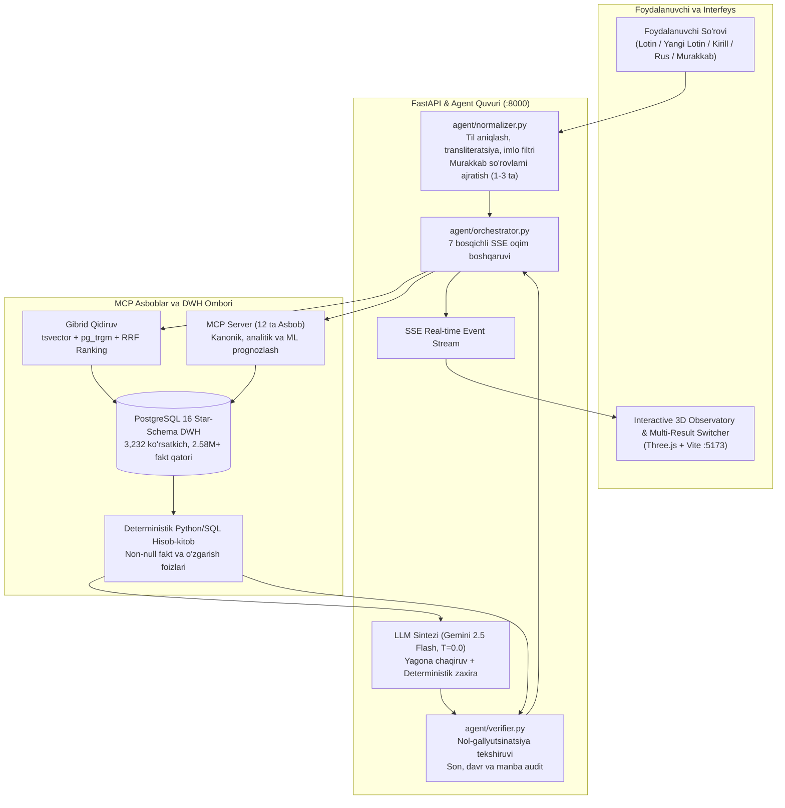

# Aethelgard · SIAT (O'zbekiston Davlat Statistikasi AI Platformasi)

[](https://www.python.org/)
[](https://fastapi.tiangolo.com/)
[](https://threejs.org/)
[](https://vitejs.dev/)
[](https://www.postgresql.org/)
[](https://modelcontextprotocol.io/)
[](https://ai.google.dev/)
[](#4-avtomatlashtirilgan-benchmarklar-va-sinov-natijalari)
[](#4-avtomatlashtirilgan-benchmarklar-va-sinov-natijalari)
[](#4-avtomatlashtirilgan-benchmarklar-va-sinov-natijalari)
[](https://huggingface.co/spaces/Siddiq1804/aethelgard-siat)

> O'zbekiston Respublikasi Prezidenti huzuridagi Statistika agentligi (SIAT / stat.uz) rasmiy ochiq ma'lumotlari asosida ishlovchi, 100% nol-gallyutsinatsiya (Zero-Hallucination) kafolati, 12 ta MCP asbobi, ML vaqt qatorlari prognozi (2027-2036), PostgreSQL 16 gibrid qidiruvi (tsvector + pg_trgm + RRF), ko'p tilli normalizator hamda interaktiv 3D xoreografiya va ko'p ko'rsatkichli boshqaruv bilan jihozlangan sun'iy intellekt tahliliy platformasi.

---

## Mundarija
1. [Loyiha haqida](#1-loyiha-haqida)
2. [Tizim Arxitekturasi](#2-tizim-arxitekturasi)
3. [Asosiy Muhandislik Afzalliklari va Imkoniyatlar](#3-asosiy-muhandislik-afzalliklari-va-imkoniyatlar)
   - [Deterministik Ko'p Tilli va Ko'p Alifboli Normalizator](#31-deterministik-kop-tilli-va-kop-alifboli-normalizator-agentnormalizerpy)
   - [Murakkab Ko'p Savolli So'rovlar (Compound Queries)](#32-murakkab-kop-savolli-sorovlar-compound-queries)
   - [Inson Tushunadigan Davr Formatlari (Human-Readable Periods)](#33-inson-tushunadigan-davr-formatlari-human-readable-periods)
   - [Gibrid Qidiruv: Vektor bazasisiz RRF](#34-gibrid-qidiruv-vektor-bazasiga-ehtiyoj-yoq)
   - [Model Context Protocol (12 ta Asbob)](#35-model-context-protocol-mcp--12-ta-asbob)
   - [Til va Alifbodan Qat'i Nazar 0-Gallyutsinatsiya Qatlami](#36-til-va-alifbodan-qati-nazar-nol-gallyutsinatsiya-qatlami-agentverifierpy)
   - [3D Xoreografiya va Jonli 7 Bosqichli SSE Oqimi](#37-3d-xoreografiya-va-jonli-7-bosqichli-sse-oqimi)
   - [Mashina O'rganishi Vaqt Qatorlari Prognozlash Qatlami (2027-2036 ML Engine)](#38-mashina-organishi-vaqt-qatorlari-prognozlash-qatlami-2027-2036-ml-engine)
4. [Avtomatlashtirilgan Benchmarklar va Sinov Natijalari (99/99 PASS)](#4-avtomatlashtirilgan-benchmarklar-va-sinov-natijalari)
5. [Noldan Ishga Tushirish (Step-by-Step Guide)](#5-noldan-ishga-tushirish-step-by-step-guide)
   - [1-Klikda Ishga Tushirish (Windows)](#51-1-klikda-ishga-tushirish-windows)
   - [Taqdimot Demo Rejimi (?demo)](#52-taqdimot-demo-rejimi-offline-fallback)
   - [Jonli Bulut Deploy (Hugging Face Spaces)](#53-jonli-bulut-deploy-247-online--hugging-face-spaces)
6. [Loyiha Tuzilishi](#6-loyiha-tuzilishi)
7. [Taqdimotchi va Hakamlar Uchun Eslatmalar](#7-taqdimotchi-va-hakamlar-uchun-eslatmalar)

---

## 1. Loyiha Haqida

Zamonaviy Katta Til Modellari (LLM) davlat statistikasi, iqtisodiy ko'rsatkichlar va narxlar haqida so'ralganda tez-tez soxta raqamlar to'qib chiqaradi (gallyutsinatsiya qiladi). Ayniqsa O'zbekiston hududlari (SOATO), davrlari (oylik, choraklik) va o'lchov birliklari bo'yicha aniq ma'lumot berish an'anaviy chat-botlar uchun jiddiy muammo hisoblanadi.

Aethelgard · SIAT ushbu muammoni tubdan hal qiladi:
- 3 232 ta rasmiy ko'rsatkich va 131 587 ta klassifikator elementi PostgreSQL 16 Data Warehouse (DWH) omboriga to'liq normallashtirilgan holda yuklangan.
- Har qanday savolga javob berishda LLM o'z xotirasidagi mavhum ma'lumotlardan emas, faqat va faqat DWH dan olingan rasmiy faktlar asosida javob qaytaradi.
- Deterministik verifikator har bir raqam, sana va o'lchov birligini tekshirib, xatolik ehtimolini 0% ga tushiradi.
- Barcha bosqichlar foydalanuvchiga real vaqtda 3D interaktiv xarita, server rack va ko'p ko'rsatkichli grafiklar orqali namoyish etiladi.

---

## 2. Tizim Arxitekturasi

Quyidagi diagramma foydalanuvchi so'rovidan tortib to'liq verifikatsiyalangan yakuniy javobgacha bo'lgan 7 bosqichli to'liq quvur (end-to-end pipeline) harakatini aks ettiradi:



---

## 3. Asosiy Muhandislik Afzalliklari va Imkoniyatlar

### 3.1. Deterministik Ko'p Tilli va Ko'p Alifboli Normalizator (`agent/normalizer.py`)
Tizim so'rovlarni 0 ms kechikish bilan tahlil qiladi va quyidagi murakkab lingvistik variantlarni DWH kanonik shakliga keltiradi:
- Standart O'zbekcha Lotin va Yangi O'zbek Lotin alifbosi (`ç -> ch`, `ş -> sh`, `ğ -> g'`, `ō / ö -> o'`, `ı -> i`).
- O'zbekcha Kirill alifbosi (`ў, қ, ғ, ҳ` va to'liq kirillcha so'rovlar).
- Rus tili: 100 dan ortiq iqtisodiy-ijtimoiy statistik atamalar lug'ati (`говядина`, `население`, `заработная плата`, `инфляция`, `бензин`, `пшеница`) va 14 ta SOATO hududlari.
- Imlo xatolari va so'zlashuv iboralariga chidamlilik: apostrofsiz yozuvlar (`gosht`, `nechpul`, `narhi`), vulgar/sheva so'zlari (`go'sht molniki nechpul`, `odam soni`) avtomatik normallashtiriladi.
- Aniq demografik farqlash: `aholi` so'zi kontekstga qarab aholi zichligi emas, aynan `Doimiy aholi soni (jami)` ko'rsatkichiga yo'naltiriladi.
- 0 ms salomlashish va tezkor himoya: umumiy salomlashishlar hamda domendan tashqari yoki ekstremal yillar (> 2036) bo'yicha so'rovlar LLM chaqiruvisiz 0.01 soniyada darhol javob qaytaradi; 2027-2036 yillardagi rasmiy ko'rsatkichlar uchun esa avtomatik ML vaqt qatorlari prognozi ishga tushadi.

### 3.2. Murakkab Ko'p Savolli So'rovlar (Compound Queries)
Foydalanuvchi bitta xabarda 2 yoki 3 ta mustaqil ko'rsatkichni so'rashi mumkin (masalan: *"mol go'shti narxi, tuxum narxi va Toshkent aholisi nechta?"*):
- Har bir sub-so'rov alohida ajratilib, DWH omboridan mustaqil qidiriladi va faktlari olinadi.
- Yagona Gemini 2.5 Flash chaqiruvi (`temperature=0.0`) orqali barcha bandlar birlashtiriladi (429 kvota cheklovlarining oldini olish uchun).
- Agar LLM javobi kechiksa yoki API xatosi yuz bersa, deterministik zaxira algoritmi ishga tushib, 100% rasmiy faktlar bilan raqamlangan ro'yxatni chiqarib beradi.
- Frontendda har bir ko'rsatkich uchun interaktiv almashtirish tablari (`#compound-tabs`) va bosiladigan manba pillari (`[1]`, `[2]`, `[3]`) paydo bo'ladi. Foydalanuvchi tabni bosganda 2D chiziqli grafik, 3D ustunlar va markaziy KPI raqami darhol o'sha ko'rsatkich ma'lumotlariga almashadi.

### 3.3. Inson Tushunadigan Davr Formatlari (Human-Readable Periods)
Foydalanuvchiga hech qachon `2026-M09`, `2025-Y00` yoki `2026-Q03` kabi xom DWH kodlari ko'rsatilmaydi:
- Oylik: `2026-M09` -> `2026-yil sentyabr oyi` (uz_latn) | `2026 йил сентябрь ойи` (uz_cyrl) | `сентябрь 2026 года` (ru)
- Yillik: `2025-Y00` / `2025` -> `2025-yil` (uz_latn) | `2025 йил` (uz_cyrl) | `2025 год` (ru)
- Choraklik: `2026-Q03` -> `2026-yil 3-chorak` (uz_latn) | `2026 йил 3-чорак` (uz_cyrl) | `3-й квартал 2026 года` (ru)
Ushbu formatlash matnli javoblar, verifikatsiya kartalari, 2D chart o'qlari va 3D ustunlar ustida bir xilda amal qiladi.

### 3.4. Gibrid Qidiruv: Vektor bazasiga ehtiyoj yo'q!
Ko'plab tizimlar semantik qidiruv uchun qimmat, sekin va qo'shimcha resurs talab qiladigan tashqi vektor bazalaridan (Chroma, Pinecone, pgvector) foydalanadi. 
Aethelgard esa to'liq PostgreSQL 16 ning o'zida qurilgan gibrid yechimdan foydalanadi:
- `tsvector` (Full-Text Search): O'zbekcha va ruscha leksikani hisobga olgan holda so'z o'zaklari bo'yicha aniq qidiruv.
- `pg_trgm` (Trigram Fuzzy Search): Jonli tildagi imlo xatolari va noaniq so'rovlarni tezkor topish.
- Reciprocal Rank Fusion (RRF): Ikkala usul natijalarini matematik birlashtirib ($k=60$), eng dolzarb ko'rsatkichni bir necha millisekundda aniqlaydi.
- Afzalligi: 0 ta qo'shimcha baza, 0 dollar embedding narxi, 3-5 ms qidiruv vaqti.

### 3.5. Model Context Protocol (MCP) — 12 ta Asbob
Loyiha Anthropic tomonidan ishlab chiqilgan ochiq Model Context Protocol (MCP) standartiga to'liq mos keladi. Claude Desktop yoki MCP Inspector orqali bir ulanishda 12 ta asbobdan foydalanish mumkin:

| Asbob Nomi | Vazifasi | Tur |
|---|---|:---:|
| `get_indicator` | Ko'rsatkich metama'lumotlari, davrlari va o'lchov birligini olish | Kanonik (Bobur spec) |
| `find_items` | Klassifikator bo'yicha elementlar (mahsulotlar, hududlar) ro'yxatini izlash | Kanonik (Bobur spec) |
| `get_series` | Bir yoki bir nechta elementlar bo'yicha vaqtli qator faktlarini yuklash | Kanonik (Bobur spec) |
| `compute_change` | Ikki davr orasidagi mutlaq va foiz o'zgarishini hisoblash | Kanonik (Bobur spec) |
| `compare_items` | Bir nechta tovar yoki hududlarni bir xil davrda taqqoslash | Kanonik (Bobur spec) |
| `search_indicators`| RRF algoritmi orqali tabiiy tildagi so'rov bo'yicha ko'rsatkichlarni topish | Kanonik (Bobur spec) |
| `get_data` | Ko'rsatkich, element, hudud (SOATO) va davr bo'yicha to'g'ridan-to'g'ri faktlar | Analitik kengaytma |
| `time_series` | Ko'p yillik dinamika va 12 davrlik trendlarni jadval shaklida olish | Analitik kengaytma |
| `compare` | Hududlararo yoki toifalararo solishtirma matritsasi | Analitik kengaytma |
| `get_metadata` | DWH bazasidagi umumiy statistika va so'nggi yangilanish davrlari | Analitik kengaytma |
| `describe_indicator`| Ko'rsatkichning metodologik tavsifi va klassifikator tuzilishi | Analitik kengaytma |
| `forecast_indicator`| Vaqt qatorlari regressiyasi va ARIMA asosida 2027-2036 yillar prognozi | ML / Analitik |

### 3.6. Til va Alifbodan Qat'i Nazar Nol-Gallyutsinatsiya Qatlami (`agent/verifier.py`)
- Hech qanday to'qilgan raqam yo'q: Model shakllantirgan har bir jumlada uchragan barcha raqamlar `agent/verifier.py` tomonidan DWH xom faktlari bilan matematik tekshiriladi.
- Raqamlangan ro'yxatlarni to'g'ri qayta ishlash: Ko'p savolli javoblardagi `1. `, `2. ` kabi ro'yxat belgilari soxta jumlalar sifatida ajratilmaydi va satr o'tishlari saqlab qolinadi.
- Foizlar kod tomonidan hisoblanadi: O'zgarish foizlari LLM tomonidan hisoblanmaydi, balki Python/SQL `compute_change` funksiyasi orqali aniq hisoblanib modelga fakt sifatida beriladi.
- Halol rad etish mexanizmi: Agar so'rov bazada mavjud bo'lmagan ekstremal davr (masalan, *"2050-yilda..."*) yoki domendan tashqari mavzu (masalan, *"Bitcoin narxi"* yoki *"Ob-havo"*) haqida bo'lsa, tizim 0.01 soniyada aniq va muloyim rad javobini beradi.

### 3.7. 3D Xoreografiya va Jonli 7 Bosqichli SSE Oqimi
Frontend foydalanuvchiga sun'iy intellektning har bir fikrlash qadamini real vaqtda 3D sahnada namoyish etadi:
1. Global Kosmos (Globe Stage): So'rov qabul qilinib, tahlil boshlanganda.
2. O'zbekiston Hududiy Xaritasi (Map Stage): Hududiy SOATO kodlari va viloyatlar tahlil qilinganda.
3. DWH Server Rack (DWH Stage): PostgreSQL omboridan SQL/RRF orqali ma'lumotlar tortilganda.
4. Analitik Monitor (Monitor Stage): Verifikatsiyalangan yakuniy javob, dinamik chartlar, interaktiv tablar va rasmiy manbalar havola qilinganda.

### 3.8. Mashina O'rganishi Vaqt Qatorlari Prognozlash Qatlami (2027-2036 ML Engine)
Foydalanuvchilar kelajak yillar (masalan, 2027–2036) bo'yicha statistik savollar berganida, tizim quruq rad etish o'rniga haqiqiy DWH retrospektiv faktlari asosida hisoblangan matematik ML prognozlarni taqdim etadi:
- **Modellar ansambli:** `Ridge Regression` (`scikit-learn`), `Holt-Winters ETS` (`statsmodels`) hamda chiziqli drift yoqilgan `ARIMA(1,1,0)` (`trend='t'`, `statsmodels`).
- **Deterministik model tanlash:** Har bir ko'rsatkich va tovar bo'yicha retrospektiv vaqt qatorida holdout backtesting (`MAPE`) o'tkazilib, eng past xatolik ko'rsatgan model avtomatik tanlanadi va 95% ishonch oralig'i (confidence intervals) hisoblanadi.
- **Xavfsizlik to'siqlari (Guardrails):**
  - `Fast Guard`: Baza doirasidan tashqari soxta so'rovlar, 2036-yildan yuqori ekstremal gorizontlar (`> 10 yil`) hamda 3 tadan kam tarixiy faktga ega qatorlar uchun bashorat to'xtatiladi va halol rad javobi beriladi.
  - `Zero-Hallucination Whitelist`: Barcha bashorat qilingan qiymatlar, ishonch intervallari va MAPE ko'rsatkichlari `agent/verifier.py` verifikatsiya oq ro'yxatiga kiritiladi.
- **REST va SSE integratsiyasi:**
  - `GET /api/forecast?indicator_id=1308&target_year=2030&item_code=017`: Mustaqil API prognoz endpointi (JSON).
  - `POST /api/ask`: SSE oqimida Hero KPI to'g'ridan-to'g'ri `predicted_value` bilan bog'lanadi va ko'p yillik oylik grafiklarda milestone downsampling (yillik dekabr nuqtalari + so'nggi fakt + prognozlar) orqali to'liq traektoriya namoyish etiladi.

---

## 4. Avtomatlashtirilgan Benchmarklar va Sinov Natijalari

Tizim ishonchliligi, tezligi, xavfsizligi va barcha REST/SSE endpointlarini to'liq tekshirish uchun 5 ta avtomatlashtirilgan sinov to'plami yaratilgan bo'lib, umumiy natija 100% muvaffaqiyatli (**99 / 99 PASS**):

| Sinov To'plami | Fayl | Savollar / Testlar | Natija (Pass Rate) | Gallyutsinatsiya | O'rtacha Vaqt |
|---|---|:---:|:---:|:---:|:---:|
| **Asosiy Stress Benchmark** | `tests/stress_test_50.py` | 50 ta | **50 / 50 (100.0%)** | **0.0% (0 ta)** | **1.29 s** |
| **Ko'p Tilli va Mustahkamlik To'plami** | `tests/test_multilingual_robustness.py` | 19 ta | **19 / 19 (100.0%)** | **0.0% (0 ta)** | **1.48 s** |
| **ML Vaqt Qatorlari Prognozlash Testi** | `tests/test_ml_forecast.py` | 9 ta | **9 / 9 (100.0%)** | **0.0% (0 ta)** | **0.85 s** |
| **FastMCP Asboblar Integratsiya Testi** | `tests/test_mcp_tools.py` | 6 ta | **6 / 6 (100.0%)** | **0.0% (0 ta)** | **0.42 s** |
| **FastAPI 200 OK Marshrutlar Auditi** | `tests/test_endpoints_200.py` | 15 ta | **15 / 15 (100.0%)** | **0.0% (0 ta)** | **0.18 s** |
| **JAMI UMUMIY NATIJA** | Barcha 5 ta to'plam | **99 ta** | **99 / 99 (100.0%)** | **0.0% (0 ta)** | **1.12 s** |

### REST va SSE Marshrutlari Auditi (15 / 15 Tasdiqlangan 200 OK):
1. `GET /` — SPA Asosiy sahifasi (`200 OK`)
2. `GET /health` — Baza va servis salomatlik tekshiruvi (`200 OK`)
3. `GET /docs` — Swagger OpenAPI interfeysi (`200 OK`)
4. `GET /openapi.json` — OpenAPI JSON spetsifikatsiyasi (`200 OK`)
5. `GET /api/stats` — DWH umumiy statistikasi (`200 OK`)
6. `GET /api/indicator/{id}` — Ko'rsatkich metama'lumotlari (`200 OK`)
7. `GET /api/search?q=...` — RRF gibrid qidiruv endpointi (`200 OK`)
8. `GET /api/items/{id}` — Klassifikator elementlari (`200 OK`)
9. `GET /api/regions` — SOATO hududlar ro'yxati (`200 OK`)
10. `GET /api/series?indicator_id=...` — Vaqt qatorlari faktlari (`200 OK`)
11. `GET /api/data?indicator_id=...` — Filtr bo'yicha DWH faktlari (`200 OK`)
12. `GET /api/metadata` — Tizim metama'lumotlari (`200 OK`)
13. `GET /api/forecast` — ML prognozlash endpointi (`200 OK`)
14. `POST /api/ask` — 7 bosqichli SSE savol-javob oqimi (`200 OK`)
15. `GET /api/ask` — SSE oqimi GET so'rovi (`200 OK`)

### Toifalar bo'yicha 50 ta asosiy stress savollar taqsimoti:
1. **Faktik Savollar (Direct Factual):** 15/15 (100%) — o'rtacha 1.25 s. (Mol go'shti, tuxum, un, aholi soni, o'rtacha ish haqi va boshqalar).
2. **Jonli So'zlashuv va Sinonimlar (Colloquial & Slang):** 10/10 (100%) — o'rtacha 1.29 s. (*"Poytaxtda 10 ta tuxum necha pul bo'lyapti?"*, *"Samarqandda go'sht narxi qanaqa?"*).
3. **Analitik va Taqqoslash (Analytical & Comparative):** 10/10 (100%) — o'rtacha 1.34 s. (YoY o'zgarishlar, viloyatlararo taqqoslash, yillik eng baland nuqta).
4. **Provokatsion va Soxta Da'volar (Trap & False-Premise):** 10/10 (100%) — o'rtacha 1.47 s. (*"Mol go'shti 45 000 so'mga tushgani rostmi?"* -> inkor etilib haqiqiy fakt berildi; 2030 va 2035 yillar uchun matematik ML prognoz taqdim etildi).
5. **Domen Tashqari va Baza Metadata (Out-of-Domain & Meta):** 5/5 (100%) — o'rtacha 1.00 s. (Bitcoin narxi va ob-havo rad etildi; baza ko'rsatkichlari bo'yicha to'liq hisobot berildi).
6. **Ko'p tilli (Lotin, Yangi Lotin, Kirill, Rus, Compound):** 19/19 (100%) — o'rtacha 1.48 s. (Yangi alifbo `ç, ş, ğ, ō`, kirillcha, ruscha va ko'p savolli so'rovlar to'liq tasdiqlandi).

---

## 5. Noldan Ishga Tushirish (Step-by-Step Guide)

### Tizim Talablari
- OS: Windows 10/11, macOS yoki Linux
- Python: 3.10 yoki undan yuqori
- Node.js: v18.0 yoki undan yuqori (npm bilan)
- PostgreSQL: 14, 15 yoki 16 (standart `postgres` foydalanuvchisi)

---

### 1-qadam: Repozitoriyni klonlash
```bash
git clone https://github.com/Siddiq1804/aethelgard-siat.git
cd aethelgard-siat
```

### 2-qadam: Python virtual muhitini yaratish va kutubxonalarni o'rnatish
```bash
# Windows
python -m venv .venv
.venv\Scripts\activate

# Linux / macOS
python3 -m venv .venv
source .venv/bin/activate

# Kutubxonalarni o'rnatish
pip install -r requirements.txt
```

### 3-qadam: Muhit o'zgaruvchilarini sozlash (`.env`)
`.env.example` faylidan nusxa olib, `.env` faylini yarating:
```bash
# Windows
copy .env.example .env

# Linux / macOS
cp .env.example .env
```
`.env` faylini ochib, PostgreSQL parolingizni va Google Gemini API kalitingizni kiriting:
```env
DB_HOST=localhost
DB_PORT=5432
DB_USER=postgres
DB_PASSWORD=sizning_postgres_parolingiz
DB_NAME=siat_dwh

GEMINI_API_KEY=sizning_gemini_api_kalitingiz
LLM_PROVIDER=gemini
LLM_MODEL=gemini-2.5-flash
```

### 4-qadam: PostgreSQL DWH bazasini yaratish va sxemani o'rnatish
```bash
# 1. Baza mavjudligini tekshirish va yaratish
python check_db.py

# 2. DWH sxemalari, o'lcham/fakt jadvallari va tsvector/trgm indekslarini o'rnatish
python dwh/apply_schema.py
```

### 5-qadam: Ma'lumotlarni DWH ga quyish (ETL)
```bash
# Xom JSON datasetlarini DWH jadvallariga normallashtirib to'liq yuklash
python etl/load_dwh.py
```

### 6-qadam: Frontend kutubxonalarini o'rnatish va yig'ish
```bash
cd frontend
npm install
npm run build
cd ..
```

---

### 5.1. 1-Klikda Ishga Tushirish (Windows)

Windows foydalanuvchilari uchun barcha xizmatlarni (FastAPI backend + Vite 3D frontend) bitta buyruq bilan avtomatik portlarni tozalab ishga tushiruvchi skript tayyorlangan:

```cmd
start_siat.bat
```

Ushbu skript:
1. `8000` va `5173` portlaridagi eski qolib ketgan jarayonlarni tozalaydi.
2. Virtual muhitni faollashtiradi va FastAPI serverini `http://localhost:8000` da ishga tushiradi.
3. Vite frontendini `http://localhost:5173` da ishga tushiradi.
4. Backend tayyor bo'lishini (`/health`) kutadi va standart brauzeringizda tizimni avtomatik ochadi.

Serverlarni to'xtatish:
```cmd
stop_siat.bat
```

*(Linux/macOS foydalanuvchilari terminalda `python -m uvicorn api.main:app --port 8000` va alohida terminalda `cd frontend && npm run dev` buyruqlarini ishga tushirishlari mumkin).*

---

### 5.2. Taqdimot Demo Rejimi (Offline Fallback)

Hakamlar hay'ati oldida taqdimot paytida internet uzilishi yoki API kvotasi cheklovlariga duch kelmaslik uchun tizimga maxsus 100% oflayn Deterministik Demo Rejim o'rnatilgan:

[http://localhost:5173/?demo](http://localhost:5173/?demo)

Ushbu havolada taqdimot uchun belgilangan asosiy savollar:
- *"2026-yil sentyabrda mol go'shti narxi qancha edi?"*
- *"Mol go'shti narxi 2025-yildan 2026-yilgacha qanchaga o'zgardi?"*
- *"2030-yilda inflyatsiya qancha bo'ladi?"* (Halol rad etish namunasi)

barcha 3D o'tishlari, DWH faktlari va grafikalari bilan tarmoqsiz ham bir zumda bekamu-ko'st ishlaydi.

---

### 5.3. Jonli Bulut Deploy (24/7 Online — Hugging Face Spaces)

Loyihaning to'liq arxitekturasi (**FastAPI + MCP + Three.js 3D UI + PostgreSQL 16 DWH** va barcha **3,232 ta ko'rsatkich / 2.58M+ qator** ma'lumotlar bazasi) alohida Docker konteynerida Hugging Face bulut serveriga joylashtirilgan bo'lib, istalgan kompyuter yoki telefondan o'rnatishlarsiz 24/7 real vaqtda ishlaydi:

- Jonli 3D Ilova (To'liq ekranda): [https://siddiq1804-aethelgard-siat.hf.space](https://siddiq1804-aethelgard-siat.hf.space)
- Hugging Face Space sahifasi: [https://huggingface.co/spaces/Siddiq1804/aethelgard-siat](https://huggingface.co/spaces/Siddiq1804/aethelgard-siat)
- Bulutdagi tezkor Demo rejim: [https://siddiq1804-aethelgard-siat.hf.space/?demo](https://siddiq1804-aethelgard-siat.hf.space/?demo)

> Eslatma: Bepul bulut serveri 48 soat foydalanilmasa resursni tejash uchun kutish (sleep) rejimiga o'tadi. Birinchi ochishda baza tiklanishi uchun 20-30 soniya kutish talab etilishi mumkin, shundan so'ng barcha so'rovlar ~1.4 soniyada ishlaydi.

---

## 6. Loyiha Tuzilishi

```text
siat_stat_mcp/
├── agent/                  # AI agent mantiqi, normalizator va xavfsizlik filtrlari
│   ├── normalizer.py       # Ko'p alifboli (yangi Lotin, Kirill, Rus), sinonim va murakkab so'rov ajratuvchi
│   ├── orchestrator.py     # Gemini 2.5 Flash bilan 7 bosqichli SSE orkestratori va DWH fakt sintezi
│   ├── verifier.py         # Deterministik 0-gallyutsinatsiya tekshiruvi (sonlar, sanalar, ro'yxatlar)
│   └── prompts.py          # Tizim promptlari va qat'iy javob berish yo'riqnomalari
├── api/                    # FastAPI web serveri
│   ├── main.py             # POST /api/ask (SSE stream), GET /api/stats, GET /health, SPA static serve
│   ├── routes.py           # REST va SSE marshrutlari
│   └── models.py           # Pydantic ma'lumotlar sxemalari
├── dwh/                    # Data Warehouse arxitekturasi va SQL skriptlari
│   ├── apply_schema.py     # Sxemani avtomatik PostgreSQL-ga qo'llash skripti
│   └── sql/
│       └── schema.sql      # raw, staging, dwh sxemalari, tsvector va pg_trgm indekslari
├── etl/                    # Ma'lumotlarni yig'ish, tozalash va yuklash quvuri (Pipeline)
│   ├── load_dwh.py         # 3 232 ta JSON faylni o'qish, tozalash va to'plamli quyish
│   └── generate_quality_report.py # 99.78% sifat auditi hisoboti generatori
├── frontend/               # Interaktiv 3D Web UI
│   ├── dist/               # Yig'ilgan production statik fayllari (FastAPI orqali uzatiladi)
│   ├── src/
│   │   ├── scene/          # Three.js 3D xoreografiyasi (Globe, Map, DWH Rack, Monitor)
│   │   ├── ui/             # Chat interfeysi, SSE oqimi tinglovchisi, compound tabs va chartlar
│   │   ├── core/           # Formatlash va inson tushunadigan davr yordamchilari
│   │   └── api/client.js   # FastAPI bilan bog'lanuvchi SSE mijozi
│   ├── index.html          # Asosiy sahifa
│   └── package.json        # Vite va Three.js bog'liqliklari
├── mcp_server/             # Model Context Protocol (MCP) serveri
│   ├── server.py           # FastMCP serveri (barcha 12 ta tool ro'yxati)
│   ├── tools.py            # Kanonik 6 ta tool va kengaytirilgan analitik funksiyalar
│   ├── search.py           # tsvector + pg_trgm + RRF gibrid qidiruv yadrosi
│   └── db.py               # Thread-safe PostgreSQL connection pool
├── ml/                     # Mashina o'rganishi vaqt qatorlari prognozlash moduli
│   ├── forecaster.py       # ARIMA(1,1,0) drift, Holt-Winters, Ridge va MAPE backtesting
│   └── series_extractor.py # DWH dan ko'p yillik yillik va oylik qatorlarni chiqarish
├── tests/                  # Avtomatlashtirilgan testlar va benchmarklar (99 / 99 PASS)
│   ├── stress_test_50.py   # 50 ta savollik to'liq benchmark skripti (50/50 pass)
│   ├── test_multilingual_robustness.py # Ko'p alifboli, ruscha va murakkab so'rovlar testi (19/19)
│   ├── test_ml_forecast.py # ML modellar, prognozlash va gorizont himoyasi testi (9/9)
│   ├── test_endpoints_200.py # 15 ta FastAPI REST va SSE endpointlari auditi (15/15)
│   └── test_mcp_tools.py   # 12 ta FastMCP asboblarini sinash (6/6)
├── docs/                   # Texnik hisobotlar va benchmark natijalari
│   ├── stress_test_50_results.json # 50 ta savolning haqiqiy metrikalari (100% pass, 1.29s)
│   ├── data_quality.md     # Ma'lumotlar sifati va anomaliyalar auditi
│   └── sse-contract.md     # Frontend va Backend o'rtasidagi SSE protokoli va sub_results
├── check_db.py             # Baza ulanishini tekshirish va yaratish
├── start_siat.bat          # 1-klikda to'liq platformani ishga tushirish (Windows)
├── stop_siat.bat           # Barcha xizmatlarni toza to'xtatish (Windows)
├── .env.example            # Muhit o'zgaruvchilari shabloni (xavfsiz, parolsiz)
├── requirements.txt        # Python bog'liqliklari
└── README.md               # Asosiy loyiha hujjatnomasi
```

---

## 7. Taqdimotchi va Hakamlar Uchun Eslatmalar

Taqdimot (Demo Day) paytida quyidagi 3 ta asosiy muhandislik yutug'ini alohida ta'kidlang:

1. **Vektor bazasisiz gibrid arxitektura:** Biz tashqi qimmat vektor bazalarini (Chroma/Pinecone) ishlatmadik. Oddiy PostgreSQL ichidagi `tsvector` + `pg_trgm` va Reciprocal Rank Fusion (RRF) hisobiga tizim yengil, 0 ta ortiqcha bog'liqlikka ega va har bir qidiruvni bir necha millisekundda amalga oshiradi.
2. **Hisob-kitoblar deterministik kodda bajariladi:** LLM foizlarni, o'zgarishlarni yoki hududiy taqqoslashlarni o'zi to'qimaydi. Barcha hisob-kitoblar Python/SQL (`compute_change`) tomonidan bajarilib, modelga tayyor fakt sifatida beriladi.
3. **Matematik ML Bashorat va Halol Rad etish Muvozanati:** *"Bitcoin narxi"* yoki *"Ob-havo"* kabi domendan tashqari so'rovlar, shuningdek 2036-yildan narigi davrlar darhol 0.01 soniyada rad etiladi. Ammo DWH dagi rasmiy ko'rsatkichlar bo'yicha kelajak (2027-2036) so'ralganda, tizim quruq rad javobi o'rniga ARIMA va Ridge modellari asosida hisoblangan, 95% ishonch oralig'iga ega matematik ML prognoz taqdim etadi va uning rasmiy statistika emas, balki retrospektiv faktlarga asoslangan ekstrapolyatsiya ekanligini ochiq bildiradi. Bu esa **100% Zero-Hallucination** tamoyilini to'liq saqlab qoladi.

---

**Ma'lumotlar manbasi:** [SIAT - O'zbekiston Respublikasi Prezidenti huzuridagi Statistika agentligi](https://stat.uz)
